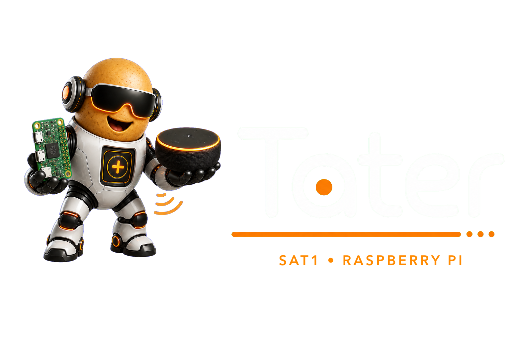

  

  

# Tater SAT1 Raspberry Pi Images

Turn a **FutureProofHomes Satellite1 HAT + Raspberry Pi Zero 2 W** into a
voice assistant. Run Tater on the device, or connect it to an existing Tater
server or Home Assistant.

## Choose your image

| Image | Use it when |
| --- | --- |
| **Tater Embedded** (`standalone`) | You want the Tater server, web interface, and voice satellite together on the Pi. |
| **Satellite only** (`satellite`) | You already run Tater elsewhere, or want to connect directly to Home Assistant through the bridge. |

Tater Embedded uses remote providers for language models, speech recognition,
and speech synthesis. Wake detection and audio run locally on the SAT1.

## What you need

- A **Satellite1 HAT with a Raspberry Pi Zero 2 W**.
- A **16 GB or larger microSD card** and a reliable power supply.
- Wi-Fi and either remote model providers, an existing Tater server, or the
  Home Assistant bridge, depending on your chosen image.

## Get started

1. [Download the latest release](https://github.com/TaterTotterson/Tater-SAT1-RPi/releases/latest)
   and choose the `standalone` or `satellite` **`.img.xz`** file.
2. In Raspberry Pi Imager, choose **Use Custom** and flash the card. Skip Wi-Fi
   customization to use the guided setup below.
3. With power disconnected, attach the HAT and insert the card. Power on and
   allow several minutes for the first boot and audio setup.
4. Join **Tater-SAT1-Setup-XXXXXX** from a phone or computer. If its setup page
   does not open, browse to **http://192.168.4.1**.
5. Enter your Wi-Fi, satellite name, and room, then choose **Save and connect**.
   For the satellite-only image, also enter your controller's URL and pairing
   code from Tater or the Home Assistant bridge.

**Tater Embedded:** open `http://<pi-ip>:8501` after it joins your network and
configure your remote model and speech providers in TaterOS.

**Satellite only:** create a pairing code in your main Tater app under
**Voice & devices → Satellites → Add Satellite** before completing setup.
For Home Assistant, follow the section below.

## Home Assistant

Choose the **satellite** image and install the
[Tater Home Assistant Satellites bridge](https://github.com/TaterTotterson/Tater-Home-Assistant-Satellites).
It connects SAT1 directly to **Home Assistant Assist** or optional **Mini-Tater**.
The main Tater app is not required for this setup.

1. Follow the [bridge installation guide](https://github.com/TaterTotterson/Tater-Home-Assistant-Satellites#get-started).
2. In Home Assistant, open **Tater Satellites → Add satellite** to get a pairing code.
3. Enter the **Home Assistant URL shown in the bridge** and that code in SAT1's
   setup page, along with your Wi-Fi details.

After pairing, manage voice settings, wake words, name, room, and volume from
**Tater Satellites** in Home Assistant.

## Everyday features

- **Wake words:** microWakeWord, openWakeWord, and NanoWakeWord, with optional
  dual-detector confirmation.
- **Recommended wake setup:** use **dual mode (MWW + OWW or MWW + NWW)** for
  fully on-device false-wake prevention. Both detectors must agree on the same
  wake phrase; this check needs no STT service.
- **MWW-only setups:** enable **STT wake verification** in Tater or the Home
  Assistant bridge for false-wake prevention through your configured STT service.
- **Speak without pausing:** a matching wake-boundary model helps preserve the start
  of commands spoken immediately after the wake word, such as
  “Hey Tater, turn on the lights.”
- **Clearer audio:** four-microphone beamforming, echo cancellation, and noise reduction.
- **Music and replies:** Sendspin playback, stereo channels, speech ducking,
  announcements, and local timers.
- **Device controls:** animated LED ring, volume buttons, and hardware microphone mute.
- **Bluetooth:** on-demand discovery and connections for compatible devices.

## Updates

Releases include flashable images and signed appliance updates. In Tater,
use the connected satellite's firmware update action. Updates preserve Wi-Fi,
pairing, and user data, with automatic rollback if startup checks fail.

Tater Embedded receives its bundled Tater updates through SAT1 releases.
See [update instructions](docs/OTA.md) and [what changed](CHANGELOG.md).

## Help and development

- [Image selection, flashing, and hardware setup](docs/IMAGE.md)
- [Wi-Fi setup and recovery](docs/PROVISIONING.md)
- [Pairing with an existing Tater server](docs/FLEET_IMAGE.md)
- [Signed updates and preserved data](docs/OTA.md)
- [Remote-only model profile](docs/EDGE_PROFILE.md)

For development, see [installation](docs/INSTALL.md),
[architecture](docs/ARCHITECTURE.md), and [upstream references](docs/UPSTREAMS.md).
Run `./script/test` for tests; see the [image guide](docs/IMAGE.md#build-locally)
to build your own image.

## License and trademarks

Licensed under [GNU AGPL v3](LICENSE). The Tater name and logo are covered by
the [Tater Trademark Policy](TRADEMARKS.md).
